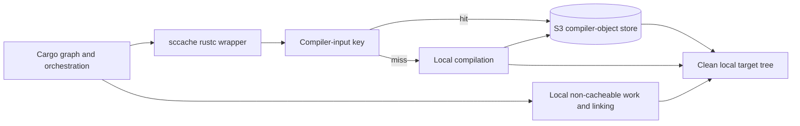

# `sccache`

## Summary

| Field         | Value                                                                                                                                                               |
| ------------- | ------------------------------------------------------------------------------------------------------------------------------------------------------------------- |
| Status        | Qualified candidate ([D7](../decisions/README.md)); on RunsOn v3.5+, prefer the isolated Magic Cache mode over direct S3                                            |
| Use when      | Jobs start with a clean target, source changes frequently, and eligible compiler outputs are reusable across commits.                                               |
| Main tradeoff | Cargo orchestration, per-object remote operations, non-cacheable calls, build scripts, and final linking still run on every job; misses also lose Cargo pipelining. |

## Related Files

| File                                                                                    | Purpose                                                                                                               |
| --------------------------------------------------------------------------------------- | --------------------------------------------------------------------------------------------------------------------- |
| [RunsOn `sccache` canary workflow](../../examples/workflows/runs-on-sccache-canary.yml) | Generic trusted-writer canary without a separate Cargo-input archive and with compiler-cache statistics.              |
| [Mr. Boxington comparison](mr-boxington.md)                                             | Experimental alternative with separate local and fresh-runner evidence.                                               |
| [Implementation reference](../reference/compiler-cache-implementation.md)               | Pinned compiler-cache behavior, embedded dependencies, durability boundaries, and dated release status.               |
| [RunsOn research](../research/runs-on-sccache/README.md)                                | Proposed lifecycle, transport, persistence, and performance work; not current features.                               |
| [RunsOn deployment](../deployments/runs-on/README.md)                                   | Direct S3 configuration, namespace, IAM, and runner-specific notes.                                                   |
| [Rust CI cache ecosystem sources](../reference/vendor-ci-cache-sources.md)              | External direct-object, near-cache-service, colocated archive-cache, persistent-runner, and compiler-wrapper designs. |

## Design

`sccache` caches eligible compiler invocations rather than a complete Cargo target tree:

```text
Cargo requests a rustc invocation
  sccache hashes compiler, source, flags, features, and relevant inputs
    hit  -> fetch and materialize that invocation's outputs
    miss -> compile locally and store the new outputs
Cargo continues orchestration and linking on the runner
```



Old compiler objects can remain in S3 until lifecycle expiry without being downloaded into every job. A lockfile, feature, compiler, or flag change creates different object keys instead of copying a previous target archive into a new one.

## Required Configuration Principles

- Set `CARGO_INCREMENTAL=0`; `sccache` and rustc incremental compilation are not compatible.
- Keep `target/` disposable and on fast local storage.
- Use a repository-, platform-, and schema-specific S3 prefix.
- Install `sccache`; enabling a backend does not install the executable.
- Print `sccache --show-stats` even when the build fails.
- Keep Cargo registry/Git input caching as a separate measured choice.
- Confirm object lifecycle, request cost, namespace growth, and error handling.

## RunsOn backends

RunsOn has two sccache integrations. The canonical configuration is in the [RunsOn deployment map](../deployments/runs-on/README.md#compiler-caches-through-magic-cache).

| Input           | Backend                                                                                                                                                    | Isolation                                                         | Status on 2026-10-15                                                          |
| --------------- | ---------------------------------------------------------------------------------------------------------------------------------------------------------- | ----------------------------------------------------------------- | ----------------------------------------------------------------------------- |
| `sccache: true` | sccache's GitHub Actions cache backend served by Magic Cache (RunsOn v3.5.0+); the action starts the server and keeps the runtime token out of later steps | GitHub branch scoping and the stack's cache isolation             | Open [runs-on/action#78](https://github.com/runs-on/action/pull/78); measured |
| `sccache: s3`   | Direct S3 in the stack bucket, with the runner role                                                                                                        | None at the IAM level: every job on the stack can write `cache/*` | Released; legacy on v3.5.0; basis of the archived S3 benchmarks               |

Both require installing `sccache` separately; `sccache: true` requires it before the action.

## Trust And Isolation

- With `sccache: true` on a stack with Magic Cache isolation, writes are limited by the job's GitHub cache token: a pull request writes only its own scope, and low-trust triggers only read.
- Direct S3 traffic does not inherit that isolation. `SCCACHE_S3_RW_MODE=READ_ONLY` limits `sccache` itself, but arbitrary workflow code can still use the runner role's stack-wide permissions. Use direct S3 only where every job is trusted, or enforce read-only access with a separate role or stack.

The writer policy must be enforced by credentials or an equivalent infrastructure boundary, not only by a workflow condition.

## What It Reuses

Current upstream Rust support caches crate outputs that do not invoke the system linker, including common `rlib`, `staticlib`, and metadata compilation. Outputs that invoke linking, such as binaries, procedural macros, `cdylib`, and `dylib`, are not cached in the same way.

Even a perfect cacheable hit rate leaves:

- Cargo dependency-graph traversal.
- Build-script execution and related orchestration.
- Procedural-macro and other linker-invoking outputs.
- Individual remote object lookups, downloads, decompression, and writes.
- Final linking and unsupported outputs.
- Creation of a fresh target tree.

## Strengths

- Reuses compiler work without restoring a complete historical target archive.
- Misses and invalidation occur per compiler invocation instead of per monolithic target tree.
- Avoids full-target tar/zstd extraction and recompression.
- Supports reuse across source changes when unaffected compiler inputs remain identical.
- Exposes hits, misses, non-cacheable calls, errors, and cache size statistics.

## Limitations

- High hit rate can still have modest absolute value on short builds.
- Thousands of small remote operations can create a latency floor.
- Build scripts, linking, and unsupported crate types remain local.
- Warm-cache and cold-population behavior differ.
- On a miss, the client passes rustc's output to Cargo only when the compile has finished, so Cargo cannot start dependent crates early (pipelining). On a large runner a cold build, or a change to a central crate, can be slower than no cache.
- Every lookup, hits included, first runs rustc with `--emit dep-info` to list the crate's sources.
- The GitHub Actions backend keeps all entries under one version that includes sccache's own version, so each upgrade starts empty, and a busy scope can exceed Magic Cache's 50,000-entry lookup index.
- Direct object storage needs lifecycle, IAM, namespace, monitoring, and cost ownership.
- A compiler-cache outage or wrapper failure needs a tested rollback to direct rustc execution.

## Evidence

- [Magic Cache benchmark](../evidence/runs-on-magic-cache-sccache-vs-mbx.md) (sccache 0.18.0, `sccache: true`, RunsOn v3.5.0, 32 vCPU): 11.7 s warm against about 32 s for no cache, but 60.0 s cold and 54.5 s on a pull request changing a central crate. Timestamped logs showed the dependents of a missed crate starting 21.5 s after it, against 12 s without a cache. Re-runs of the same pull request wrote their 30 entries under new keys each time and never reused them; the cause was not found.
- [Cache-strategy benchmarks](../evidence/cache-strategy-benchmarks.md) (direct S3, sccache 0.17): the strong default-server warm result, cold-population regression, input-archive ablation, slower client-side modes, and incomplete multilevel writes. The read-only control showed that uploads were not the sole cold penalty.
- [Mr. Boxington comparison](../evidence/mr-boxington-vs-sccache.md): separate local and containerized fresh-runner observations.

## Decision

[D7](../decisions/README.md) owns the status. On RunsOn v3.5+, use the isolated Magic Cache mode rather than direct S3, and qualify it on the target runner size and change pattern: its warm benefit can be outweighed by its miss path. Do not combine it with a separate input-only Cargo archive by default, do not enable client-side or multilevel modes from architecture claims alone, keep a direct-rustc rollback, and do not adopt any mode from hit rate alone.

## Upstream References

- [`sccache` Rust support and limitations](https://github.com/mozilla/sccache/blob/main/docs/Rust.md)
- [`sccache` S3 backend](https://github.com/mozilla/sccache/blob/main/docs/S3.md)
- [`Mozilla-Actions/sccache-action`](https://github.com/Mozilla-Actions/sccache-action)
- [RunsOn `sccache` example](https://github.com/runs-on/action#sccache)
- [sccache GitHub Actions cache backend](https://github.com/mozilla/sccache/blob/main/docs/GHA.md)
